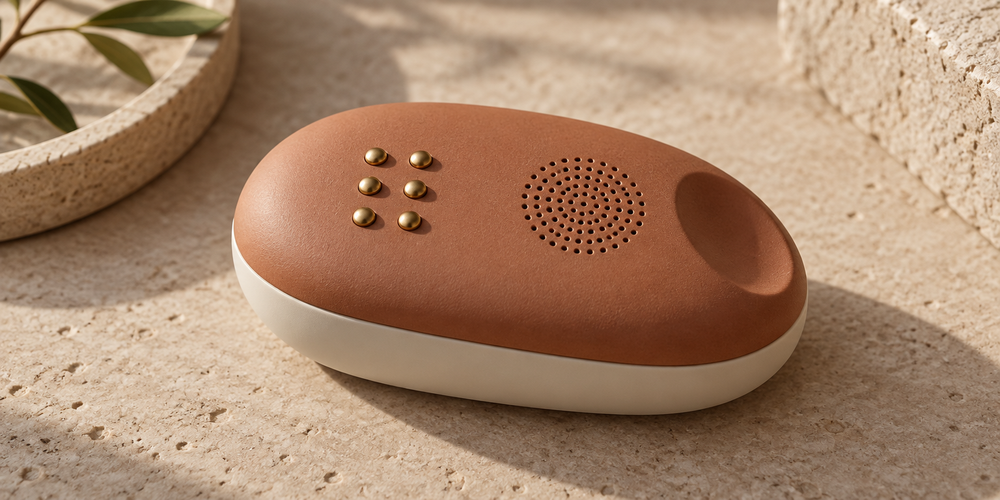

<div align="center">
  
</div>

<p align="center">
  <a href="https://diufoundry.online"></a>&nbsp;
  &nbsp;
  &nbsp;
  
</p>

<p align="center">
  <b>Bridging physical tactile dots and acoustic speech with zero cognitive friction.</b><br/>
  <em>An inclusive, client-side audio-tactile translation workspace featuring optical Braille document scanning and low-latency voice synthesis.</em>
</p>

---

## ✦ System Overview

The **Braille Voice Guide** is an accessibility workbench developed by DIU Foundry. It transforms visual and alphanumeric communication into dual sensory channels: embossed 6-dot Braille patterns and natural neural speech. Designed for universal learning and literacy, the application operates with local-first responsiveness across touch-enabled surfaces and edge compute.

```text
 ┌─────────────────────────────────────────────────────────────────────────────┐
 │                         AUDIO-TACTILE LEARNING ENGINE                       │
 ├─────────────────────┬───────────────────────────────┬───────────────────────┤
 │ 6-DOT BRAILLE MATRIX│ ACOUSTIC FREQUENCY SYNTHESIS  │ OPTICAL CAMERA SCAN   │
 │ Multi-touch Tactile │ Neural TTS: 24 kHz Low-Jitter │ Document OCR: Active  │
 └─────────────────────┴───────────────────────────────┴───────────────────────┘
```

---

## 🎧 Architecture & Processing Pipeline

```text
[ USER INPUT (Optical Scan / Alphanumeric Text) ]
        │
        ▼
[ DOCUMENT SCANNER & OCR WORKER ] (`src/routes/scanner.tsx`)
        │
        ▼
[ BRAILLE ENCODING ENGINE ] (`src/services/brailleApi.ts`)
        │
        ├─► [ 6-DOT TACTILE HAPTIC EMISSION ] ──► (Simulated Screen Relief & Dot Pin Grid)
        │
        └─► [ SPEECH HARMONIC SYNTHESIS ] (`src/services/voiceService.ts`)
                    │
                    ▼
            [ WEB AUDIO API ENGINE ] ──► (Directional Auditory Feedback)
```

---

## ✦ Key Systems & Capabilities

- **Interactive Braille Cell Matrix** — Real-time 6-pin tactile relief simulator mapping standard Unified English Braille (UEB) symbols.
- **Optical Document Scanner** (`src/routes/scanner.tsx`) — Camera-assisted document capture that extracts printed letters and converts them into audible braille sequences.
- **Neural Voice Synthesis** (`src/services/voiceService.ts`) — Context-sensitive acoustic pronunciation guiding visually impaired users through tactile layout navigation.
- **Cloudflare Edge Deployment** — Serverless edge distribution ensuring ultra-fast load times with zero server-side tracking.

---

## 🛠️ Project Structure

```text
braille-voice-guide/
├── public/                 # Sound effects, speech models & phonetic dictionaries
├── src/
│   ├── components/         # Tactile braille pins & Radix accessible primitives
│   ├── routes/             # TanStack routing layer
│   │   ├── index.tsx       # Primary audio-tactile translation workbench
│   │   ├── scanner.tsx     # Optical camera scanner & OCR interface
│   │   ├── demo.tsx        # Interactive Braille learning playground
│   │   ├── architecture.tsx# Systems design & audio pipeline documentation
│   │   └── innovation.tsx  # Haptic & accessibility research notes
│   ├── services/
│   │   ├── brailleApi.ts   # Alphanumeric to 6-dot Braille bitmask encoder
│   │   └── voiceService.ts # Web Audio API voice synthesis wrapper
│   └── styles.css          # Warm terracotta clay & acoustic typography variables
└── package.json            # Cloudflare Vite plugin, Radix UI, TanStack Router
```

---

## ⚡ Quickstart

```bash
# Clone repository
git clone https://github.com/Kishordiu/braille-voice-guide.git
cd braille-voice-guide

# Install dependencies
bun install  # or npm install

# Launch accessibility workbench
bun run dev
```

Navigate to [http://localhost:5173](http://localhost:5173) and test both voice guidance and the 6-dot interactive simulator.

---

<p align="center">
  <b>RESEARCH → BUILD → TEST → SHIP</b><br/>
  <sub>An accessible innovation by <a href="https://diufoundry.online">DIU Foundry</a> · Engineered by K. Kishor Kumar</sub>
</p>
